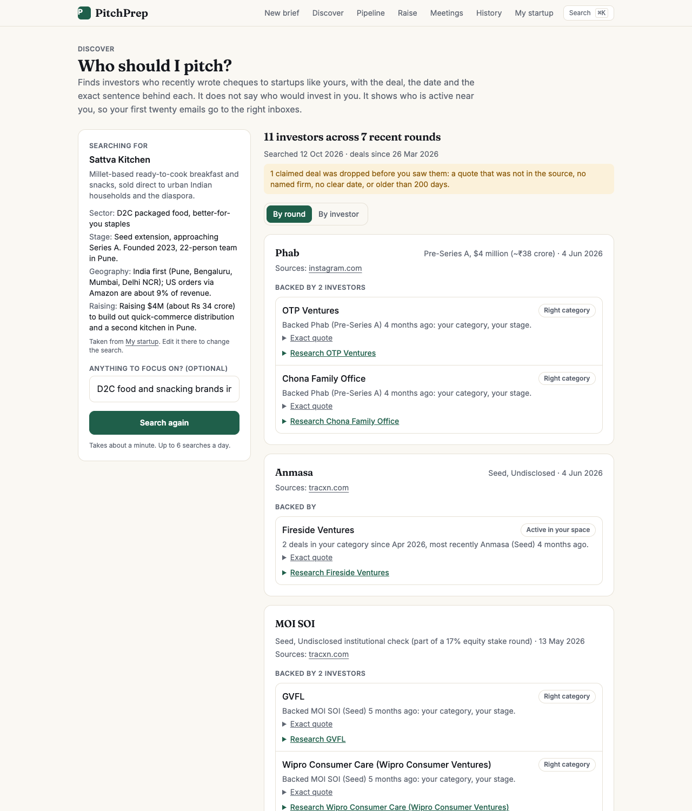
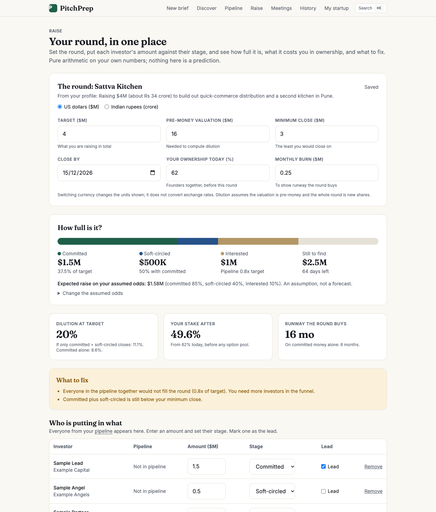
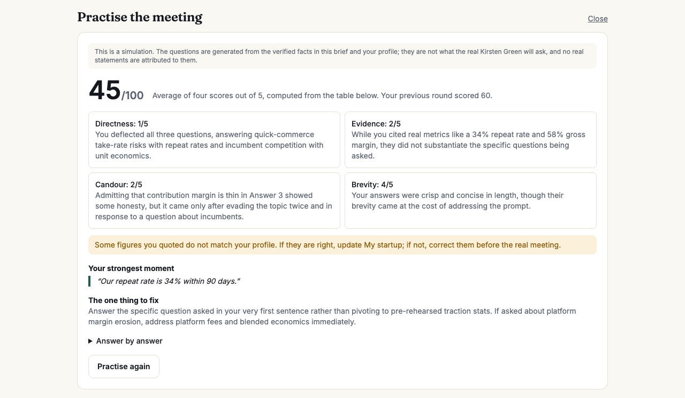
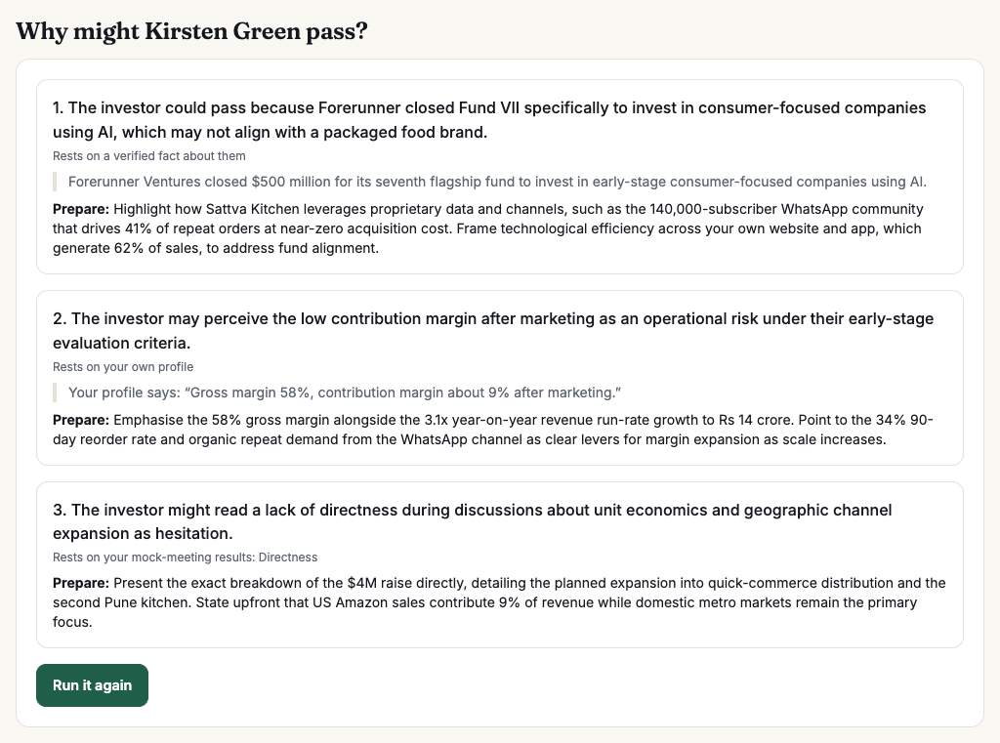
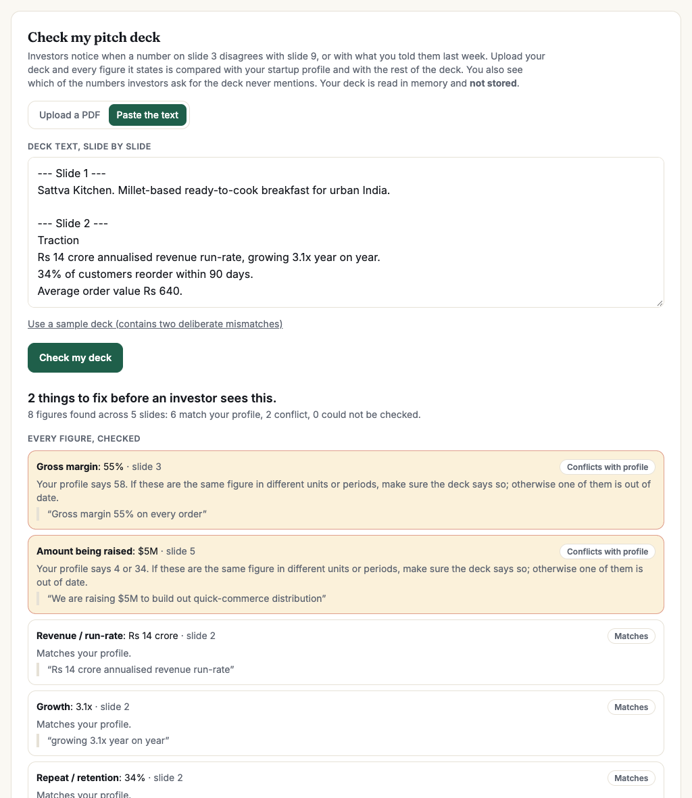
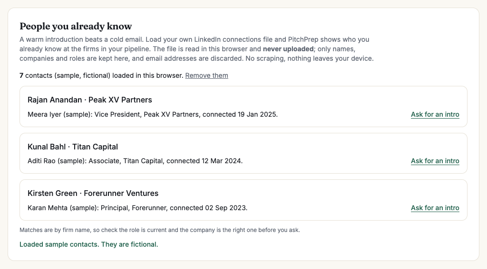

# PitchPrep: pre-meeting investor briefs

MESA Cohort C4, AI and its Applications, Section 1 Final Examination, Problem 1 (Pre-Meeting Investor Brief).

Enter an investor's name and firm. Get a structured, sourced, fact-checked brief in about a minute: recent portfolio activity (last 90 days), publicly stated thesis, watch-outs, three talking points tailored to your startup, and a verification trail. All AI is Gemini Flash.

- **Live app:** https://pitchprep-three.vercel.app
- **Repository:** https://github.com/siddhantbassi-commits/pitchprep
- **Components Map:** [docs/Components-Map.pdf](docs/Components-Map.pdf)
- **Scope and decisions:** [docs/SCOPE.md](docs/SCOPE.md) · **Automation brief:** [docs/automation-brief.md](docs/automation-brief.md) · **Nine checks and the Cut:** [docs/nine-checks.md](docs/nine-checks.md)
- **Evidence:** [docs/eval-report.md](docs/eval-report.md) (live evaluation) · [docs/model-comparison.md](docs/model-comparison.md)

## See it

<p align="center"></p>

| Home | Evidence (live evaluation) | Dashboard |
|---|---|---|
|  |  |  |

| Discover: who should I pitch? | Raise: the round in one place | Mock meeting scorecard |
|---|---|---|
|  |  |  |

| Pre-mortem: why might they pass? | Check my pitch deck | People you already know |
|---|---|---|
|  |  |  |

<sub>The Raise screenshot uses the sample founder with placeholder investors ("Sample Lead, Example Capital"); no real person is shown as having committed. The warm-path screenshot uses clearly fictional sample contacts.</sub>

**Components Map** ([PDF](docs/Components-Map.pdf)):


## How it works
Five parallel Gemini Flash searches (Google Search grounding) -> open and date every source -> extract claims with exact quotes (no tools) -> verify in code (quote in source, about this investor, dated inside 90 days, no duplicates) plus a fact-check pass -> write talking points from verified claims only. Code, not the model, decides what is shown. Details in [docs/SCOPE.md](docs/SCOPE.md).

## Run locally
```bash
npm install
cp .env.example .env.local      # fill in GEMINI_API_KEY and the Supabase values
npm run db:setup -- --create    # optional: creates the Supabase project and applies supabase/schema.sql
npm run dev
```
Or apply `supabase/schema.sql` yourself in the Supabase SQL editor.

| Command | What it does |
|---|---|
| `npm test` | 124 unit tests (verification gate, dates, quotes, SSRF guard, robots, tiers, delta, calendar parser, number checker, email layout, encryption, nudge scheduling incl. bump and weekly rules, signed links, email templates, investor discovery verification and ranking, mock-meeting scoring, raise arithmetic, pitch-readiness rules, deck consistency, contact matching, pre-mortem tracing, practice progress) |
| `npm run seed` | Generate the example briefs shown on the home page (live data; a thin run is retried up to twice, unlike the evaluation, which is never filtered) |
| `npm run cal-test -- file.ics` | Test investor-meeting detection on a calendar file |
| `npm run discover -- "focus"` | Run investor discovery in the terminal and re-audit every deal against its source |
| `npm run run -- "Name" "Firm"` | Run the whole pipeline in the terminal, no database needed |
| `npm run eval` | Golden-set evaluation (writes docs/eval-report.md) |
| `npm run typecheck` | TypeScript check |

## Environment
`GEMINI_API_KEY`, `GEMINI_MODEL` (default `gemini-3.8-flash`), `SUPABASE_URL`, `SUPABASE_SERVICE_ROLE_KEY`, `CRON_SECRET`. The service key is used only on the server; browsers never talk to the database.

## Beyond the brief
Not just a brief: the whole fundraising workflow around it.
- **Find:** **Discover** answers "who should I pitch?": investors who recently backed startups like hers, grouped by funding round, each with a plain reason for the match, its date, exact quote and source. **People you already know** matches her own LinkedIn connections file to the firms in her pipeline, entirely in her browser. A **pitch readiness check** lists the numbers investors will ask for that her profile is missing.
- **Before:** founder profile, cited and quoted claims, fit snapshot, questions to ask *them*, phone-friendly **meeting card**, **calendar link** that finds investor meetings and prepares briefs automatically (try it with a sample calendar), compared-with-last-time panel.
- **Practise:** a **pre-mortem** ("why might they pass?", every reason tied to a verified fact, a line of her profile or her own practice results), a five-question **mock meeting** with a simulated investor (friendly or tough) that uses only verified facts, then a scorecard in which every figure she quoted is checked against her profile and the "strongest moment" must be a verbatim quote. A **practice progress** chart shows whether rounds are improving and which skill keeps scoring low.
- **After:** investor **pipeline** ranked by fit with status, next step and notes; **follow-up email draft** from her notes; **answer rehearsal** where code checks every figure against her profile.
- **Nudges:** confirm-first **email nudges** (brief ready, a refreshed brief with what is new before the meeting, follow-up and overdue reminders) with one-tap links that sign you in on your phone; **double-check list**, **listen mode**, **patterns across your notes**, **intro-message drafts** (including a **forwardable blurb** so a mutual contact can introduce her in ten seconds), **⌘K palette**.
- **Raise:** a **deck check** that reads her pitch deck (PDF or pasted text) and flags every figure that conflicts with her profile or with another slide, plus the numbers investors ask for that the deck never states; a **round tracker** (target, pre-money, commitments by stage, lead) showing progress, dilution, runway and warnings, with every assumption editable; weekly **Monday summary** and a gentle **bump** draft a week after a follow-up with no reply.
- **Trust:** per-claim feedback, ops dashboard with cost per brief, in-product [Evidence page](https://pitchprep-three.vercel.app/evidence), real data deletion, injection / SSRF / rate-limit protections, accessibility, dark mode, installable on a phone.

New here? Follow the [three-minute tour](docs/tour.md).

## What it deliberately does not do
No LinkedIn scraping, nothing personal about anyone, no predictions, no contacting investors, no claim without a quote from its source.
